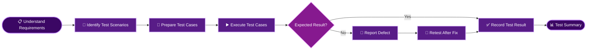

<div align="center">


<h1 align="center">MANJULA SWAMI</h1>


<br/>


<br/><br/>

<a href="https://www.linkedin.com/in/manjula-swami-3a9399357">
  
</a>
<a href="mailto:manjulaswami27092002@gmail.com">
  
</a>


</div>


<div align="center">
  
</div>

<table>
<tr>
<td width="58%" valign="top">

### Hello, I'm Manjula 👋

I am a **Software Tester** from Ratnagiri, Maharashtra, India, with **6 months of internship experience as a QA / Manual Tester at Pleximus Inc.**

I am interested in software quality and enjoy exploring applications, understanding requirements, preparing test cases, executing test scenarios, and identifying defects.

- 🧪 Focused on **Manual Testing**
- 🔍 Interested in **Software Quality Assurance**
- 🤖 Exploring **Automation Testing**
- 🔗 Interested in **API Testing**
- 📝 Enjoy test case design and defect documentation
- 🌱 Always learning and improving my testing skills

</td>
<td width="42%" valign="top">

```bash
$ whoami
manjula-swami

$ cat profile.yml
name: Manjula Swami
role: Software Tester
location: Ratnagiri, India

experience:
  position: QA / Manual Tester Intern
  duration: 6 months
  company: Pleximus Inc.

interests:
  - Manual Testing
  - Automation Testing
  - API Testing

$ echo $MINDSET
LEARN | TEST | IMPROVE
```

</td>
</tr>
</table>

> **My approach:** Understand the requirement, think from the user's perspective, test carefully, and report defects clearly.


<div align="center">
  
</div>

<div align="center">



</div>


<div align="center">
  
</div>

<div align="center">


</div>

| Domain | Skills / Knowledge |
|:---:|:---|
| 🧪 **Testing Types** | Manual, Functional, Regression, Smoke, Sanity |
| 📝 **Test Documentation** | Test Scenarios, Test Cases, Test Execution, Bug Reports |
| 🐞 **Defect Management** | Bug Identification, Defect Reporting, Severity, Priority, Retesting |
| 🔄 **Testing Process** | SDLC, STLC, Defect Life Cycle |
| 🤖 **Automation Testing** | Area of interest / developing skills |
| 🔌 **API Testing** | Area of interest / developing skills |
| 💻 **Technical Skills** | Core Java, MySQL, Excel |

<div align="center">

### Tools & Technologies


<br/>


</div>

<sub>Note: Automation Testing, API Testing and Selenium are areas of interest or learning, not claimed as professional experience.</sub>


<div align="center">
  
</div>

<table>
<tr>
<td width="100%" valign="top">

### 🧪 QA / Manual Tester Intern

**Pleximus Inc.** · **6 Months**

- Performed manual testing of web application features and modules.
- Prepared test cases and test scenarios based on assigned requirements.
- Executed test cases and verified actual results against expected results.
- Identified UI and functional issues and documented defects.
- Maintained testing observations and defect details using Excel.
- Checked form fields, validations, buttons, and module-level functionality.

</td>
</tr>
</table>


<div align="center">
  
</div>

<div align="center">

<a href="https://github.com/ManjulaSwami">
  
</a>
<a href="https://github.com/ManjulaSwami">
  
</a>

<br/><br/>


</div>


<div align="center">
  

I am interested in opportunities in **Software Testing and Quality Assurance**.

<a href="https://www.linkedin.com/in/manjula-swami-3a9399357">
  
</a>
<a href="mailto:manjulaswami27092002@gmail.com">
  
</a>

<br/><br/>


**Thanks for visiting my profile! 💜**

</div>
