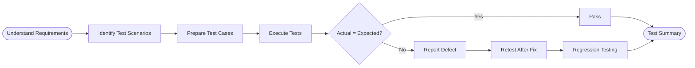

  
  
  
   
  
  
  
    
  
  

  

### Hello, I'm Manjula 👋

I'm a **Software Tester / Manual QA Tester** with **6 months of experience** in software quality assurance. I enjoy understanding application requirements, preparing test cases, identifying defects, and helping teams deliver reliable, user-friendly software.

- 🧪 Manual testing of web applications
- 📝 Preparing and executing test cases and test scenarios
- 🐞 Identifying, documenting, and reporting bugs
- 🔍 Functional, regression, smoke, and retesting activities
- 🗄️ Writing SQL queries to validate database records
- 📊 Maintaining test documentation and reports using Excel

> **Career focus:** Software Testing, Manual QA, and continuous improvement of application quality.

  

  

| Area | Skills |
|:---|:---|
| 🧪 Manual Testing | Functional, Smoke, Sanity, Regression, Retesting |
| 📝 Test Documentation | Test Cases, Test Scenarios, Test Data, Test Reports |
| 🐞 Defect Management | Bug Reporting, Severity, Priority, Defect Life Cycle |
| 🔄 Testing Concepts | SDLC, STLC, Test Life Cycle |
| 🗄️ Database | MySQL, SQL Queries, Data Validation |
| 📊 Documentation Tools | Microsoft Excel |

  
  
  

  

### Manual / QA Tester — 6 Months

**Key responsibilities**
- Reviewed application requirements and understood expected functionality.
- Prepared test scenarios and detailed test cases for application modules.
- Executed test cases and compared actual results with expected results.
- Identified defects and documented them with clear steps to reproduce.
- Worked on functional checks, regression testing, and retesting.
- Maintained test case and defect records using Excel.

  

### Master of Computer Applications (MCA)

Completed MCA in 2026.

  
    
  **Interested in software quality, testing, and building better applications? Let's connect.**
    
  
    
  
  

