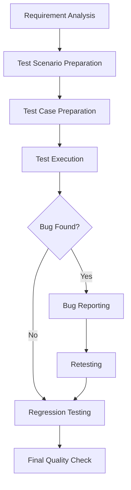

# MANJULA SWAMI

 

  

---

## 👩‍💻 ABOUT ME

Hello! I'm **Manjula Swami**, a passionate **Manual QA Tester / Software Tester** with **6 months of experience** in software testing.

I enjoy identifying bugs, testing application functionality, preparing test cases, and ensuring that applications meet user expectations.

- 🔍 Manual Software Testing
- 📝 Test Case and Test Scenario Preparation
- 🐞 Bug Identification and Reporting
- 🔄 Retesting and Regression Testing
- 🎯 Functional and UI Testing
- 📊 Test Documentation using Excel

---

## 🧪 MY TESTING PROCESS

---

## 🛠️ QA SKILLS

| Category | Skills |
|---|---|
| Testing | Manual, Functional, UI, Smoke, Regression |
| Documentation | Test Cases, Test Scenarios, Bug Reports |
| Bug Analysis | Severity, Priority, Expected Result, Actual Result |
| Tools | Microsoft Excel |

---

## 💼 PROFESSIONAL EXPERIENCE

### Manual / QA Tester Intern

**Pleximus Inc.** | 6 Months

- Prepared test cases for application forms and login functionality.
- Tested different website modules and functionalities.
- Identified bugs and documented defects using Excel.
- Performed UI testing across application modules.
- Verified reported issues through retesting.

---

## 🎯 MY GOAL

To grow as a Software Testing professional, continuously improve my testing knowledge, identify defects effectively, and contribute to delivering high-quality software applications.

---

## 🤝 LET'S CONNECT

I'm interested in Software Testing, Quality Assurance, and learning new testing technologies.

  

