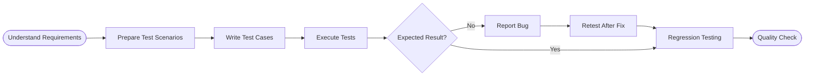

 

  

## ABOUT ME

Hello! I'm **Manjula Swami**, a **Manual QA Tester / Software Tester** with **6 months of experience** in software testing.

I am interested in ensuring software quality by checking application functionality, identifying defects, preparing test cases, and reporting bugs clearly. I focus on understanding requirements, testing real user scenarios, and helping deliver reliable and user-friendly applications.

- 🔍 Manual testing and test execution
- 📝 Test case and test scenario preparation
- 🐞 Bug identification, documentation, and reporting
- 🔁 Retesting and regression testing
- 🎯 Functional and UI testing
- 📊 Test documentation using Excel

> **My goal:** To contribute to software quality by finding issues early and helping create dependable user experiences.

## MY TESTING APPROACH

## QA SKILLS

| Area | Skills |
|:---|:---|
| **Testing** | Manual, Functional, UI, Smoke, Regression, Retesting |
| **Test Documentation** | Test Scenarios, Test Cases, Test Data, Bug Reports |
| **Defect Analysis** | Severity, Priority, Expected Result, Actual Result |
| **Tools** | Microsoft Excel |

## EXPERIENCE

### Manual / QA Tester Intern

**Pleximus Inc.** · 6 months

- Prepared test cases for application forms and login functionality.
- Tested website modules and checked whether features behaved as expected.
- Identified defects and documented issues in Excel.
- Performed UI checks across application modules.
- Supported retesting and verification of reported issues.

## WHAT I VALUE IN SOFTWARE TESTING

- **Quality first:** Check that features work according to requirements.
- **Attention to detail:** Explore different inputs and user scenarios.
- **Clear communication:** Report defects with clear steps to reproduce.
- **User perspective:** Consider usability and the overall user experience.
- **Continuous learning:** Keep improving testing knowledge and practices.

## LET'S CONNECT

I'm interested in learning, collaborating, and growing in the field of **Software Testing and Quality Assurance**.

  

